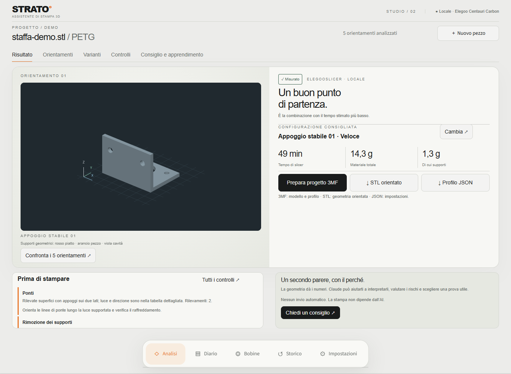
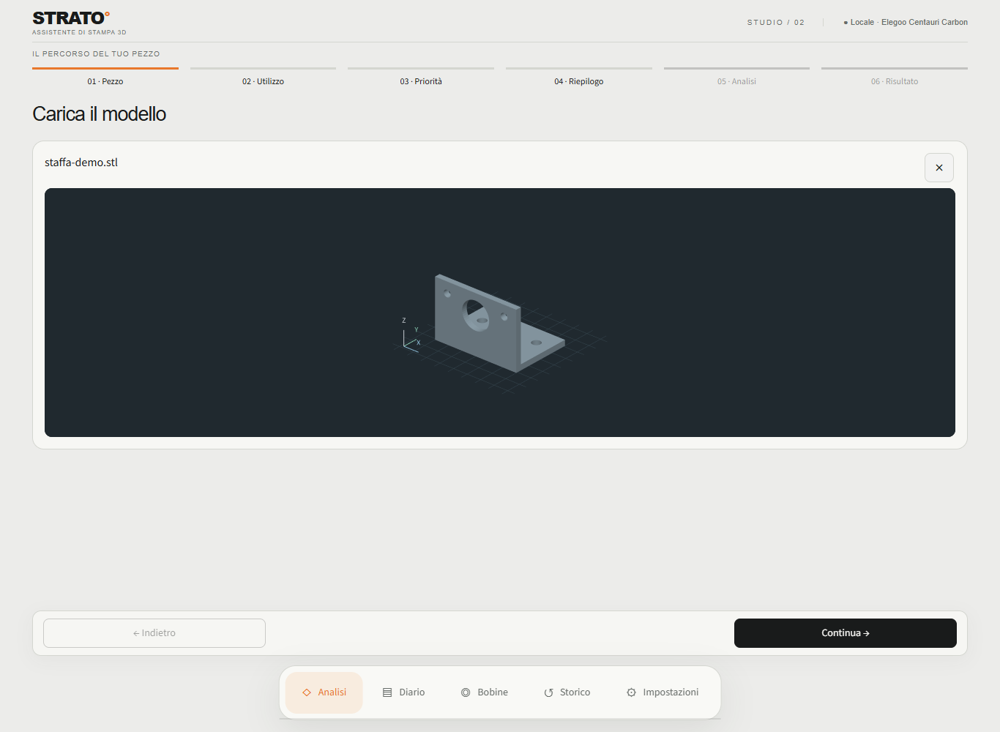
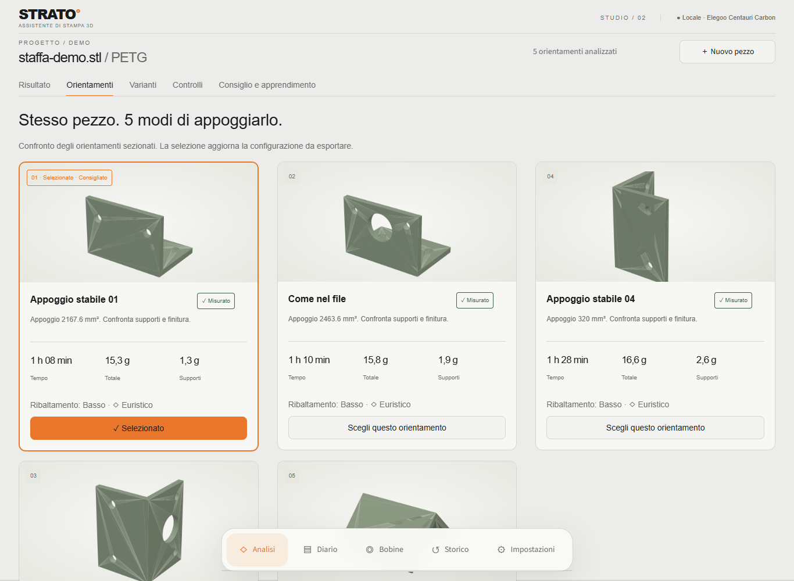
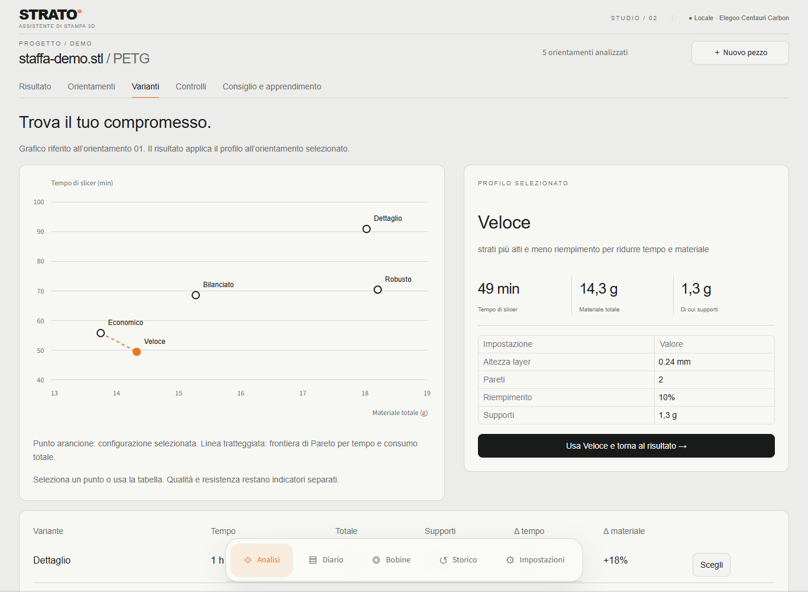

# STRATO · 3D Printing Assistant

*[Leggi in italiano](README.md). The current user interface and source code are in Italian.*

Prepare an FDM model: inspect the part in 3D, compare orientations and process profiles,
review potential problems and export the selected configuration. Geometric analysis, slicing
and comparison work without AI; Claude adds explanations and diagnosis only when requested.

This project was developed with assistance from AI coding agents, including Claude Code and
OpenAI Codex, under the author's direction.



## Current interface

The guided workflow **Pezzo → Utilizzo → Priorità → Riepilogo → Analisi → Risultato**
(model, usage, priority, summary, analysis, result) preserves your choices while navigating.
**Indietro** (Back), **Continua** (Continue) and **Avvia analisi** (Start analysis) stay visible
above the main navigation, even on long forms.

- **Upload:** STL, 3MF and OBJ; STEP/STP with the augura add-on. A single panel switches from
  upload to preview. The **X** removes the file so you can load another model.
- **Local 3D viewer:** rotation, zoom and panning with Plotly, a dark background, bed grid and
  XYZ axes. The upload view shows a neutral model; in the result, faces can highlight geometric
  support requirements: red from the bed, orange on the part, purple inside cavities. These
  colours do not represent the actual toolpath: always check the slicer preview.
- **Risultato** (Result): oriented model, configuration, time and material, exports,
  pre-print checks and optional Claude advice.
- **Orientamenti** (Orientations): cards with thumbnails, contact area, time and supports.
  Selecting a card updates the configuration available for export.
- **Varianti** (Variants): a selectable time/material chart, profile parameters and a comparison
  table. The chart line is the Pareto front for time and total consumption; surface quality
  and strength indicators remain separate.
- **Controlli** (Checks) and **Consiglio e apprendimento** (Advice and learning): geometric
  checks, toolpath details, images and explanations without crowding the main result.

The bottom navigation opens **Analisi**, **Diario**, **Bobine**, **Storico** and **Impostazioni**
(Analysis, Journal, Spools, History, Settings). Thumbnails and PNG images for Claude's analysis
remain available alongside the interactive viewer.

<details>
<summary>More screenshots: upload, orientations and variants</summary>

### Upload and 3D viewer



### Orientation comparison



### Process variant comparison



</details>

Screenshots show the actual Italian interface and a bracket generated for the documentation,
with local analysis and slicing. They contain no personal models, journal or spool inventory.
Times and consumption belong to this example and do not apply to other parts.

## Requirements and getting started

Tested on **Windows with Python 3.12**. The current launch scripts and slicer paths are
Windows-specific. The browser needs WebGL support for the interactive viewer.

- **ElegooSlicer is optional:** it provides G-code time/material values, process comparison and
  verified print exports. The initial configuration targets **Elegoo Centauri Carbon with a
  0.4 mm nozzle**, using the profiles in `config.py`; installation paths can be configured as described below.
- **augura is optional:** it adds STEP/STP support and dedicated checks in a separate environment.
- **Claude is optional:** requests use the Claude Agent SDK and the authentication available
  in your Claude Code environment or `ANTHROPIC_API_KEY`. Local analysis needs no authentication.

Double-click `avvia.bat`: on the first launch it creates `.venv` and installs `requirements.txt`.
Or run these commands from the project directory:

```powershell
python -m venv .venv
.venv\Scripts\python.exe -m pip install -r requirements.txt
.venv\Scripts\python.exe -m streamlit run app.py
```

Open http://localhost:8501. The server is configured to accept connections only from this PC.
After updating the project, reinstall dependencies with
`.venv\Scripts\python.exe -m pip install -r requirements.txt`, even if `.venv` already exists.

Open **Impostazioni** (Settings) to check the printer, slicer availability and filament profile;
you can also manage augura and select the Claude model there. Trimesh, Plotly, Matplotlib and the
Claude SDK load when needed for a model, rendering or request, rather than all at startup.

## Verification

From the project directory:

```powershell
.venv\Scripts\python.exe -m unittest discover -s tests -t . -q
```

The suite covers geometry, persistence, the guided workflow, the 3D viewer and exports.
A separate browser job checks uploads, navigation, responsive action buttons and 3D rendering in Chromium.
Commands and scope: [CONTRIBUTING.md](CONTRIBUTING.md#browser-tests).
Unit tests use synthetic slicer profiles and need no ElegooSlicer installation. Printability checks are sampled or heuristic:
they do not replace G-code inspection or certify the part's strength.

### Slicer paths and end-to-end verification

CI publishes line and branch coverage and the least-covered modules in each run summary.
The `coverage-report` artifact contains browsable HTML, JSON and XML, retained for 14 days.
Local commands and measurement limits: [CONTRIBUTING.md](CONTRIBUTING.md#coverage).

Set these environment variables before starting the app to override the defaults in `config.py`:

```powershell
$env:STRATO_SLICER_EXE = 'D:\ElegooSlicer\elegoo-slicer.exe'
$env:STRATO_SLICER_PROFILES = 'D:\ElegooSlicer\resources\profiles\Elegoo'
```

Without an explicit profiles path, it is derived from the executable directory. Relative paths
start at the project directory. Settings displays the active paths. The optional real-slicer
verification uses temporary data:

```powershell
.venv\Scripts\python.exe tests/integrazione_worker.py
```

It explicitly reports SKIP when the slicer is unavailable. See [CONTRIBUTING.md](CONTRIBUTING.md)
for development and [SECURITY.md](SECURITY.md) for private vulnerability reporting.

## How it works

1. **Geometric analysis** (`analisi.py`, no AI): dimensions, volume, wall thickness, and for each
   candidate orientation (the one in the file plus the stable poses) the bed contact area and the
   surfaces that need supports, distinguishing supports that start from the bed from those that
   would rest on the part. Among supports from the bed it recognises those **inside a cavity**: at
   some height the support column has the part around it in all 16 horizontal directions (an
   upside-down cup, a box open at the bottom). The slicer builds them, but after printing they can
   only be removed through the opening on the bed. A tunnel open at the sides does not count as a
   cavity; a side slit narrower than the rays can be missed.
   For each orientation it also checks whether the part **tips over** (centre of mass outside the
   footprint on the bed) and whether a **brim** is needed.
   **Score** (lower = better): area of supports from the bed + 3 × area of supports on the part
   + 2 × area inside cavities (so it weighs 3 in total) + 0.02 × support volume + stability penalty. If the part touches the bed only with edges (less
   than 10 mm²) or tips over, each problem adds the part's **footprint on the bed** (minimum 200):
   an unstable part has to be held by brim or supports over its whole shadow. Weights and thresholds
   are at the top of `analisi.py`; the support threshold is in `config.py` (`SOGLIA_SUPPORTI`), the
   same one the slicer uses in real slicing.
   The candidates also include the choices of the **slicer's automatic orientation**
   (`orienta_slicer.py`): the OrcaSlicer algorithm, from which ElegooSlicer derives, translated into
   Python in the two modes the slicer uses it (the "Orient" button in the interface and the command
   line). The translation was checked against `elegoo-slicer.exe --orient 1`: same candidates, costs
   with a median deviation of 0.1%, same choice. The page shows who picks what: our ranking, the
   slicer and Claude.
2. **Viewer and images** (`visualizzatore.py`, `anteprima.py`, `render.py`): an interactive 3D
   preview during upload and in the result, orientation thumbnails and PNGs for Claude.
   Coloured faces distinguish supports from the bed, on the part and inside cavities:
   these are geometric indications, not a toolpath simulation.
3. **Advice** (`consiglio.py`): Claude receives the numbers, the images, the printer, the purpose of
   the part and the journal, and answers with orientation, material, settings with their reasons,
   risks, a concept to learn and an experiment.
4. **Journal** (`diario.py`): after each print you record outcome, problems and photos; Claude can
   diagnose them, and the entries feed into later advice.

Claude is used through the **Claude Agent SDK** with your environment's credentials.
Requests are sent only when you press the advice or diagnosis button. File reads are allowed,
commands and changes are not; the actual read scope is described under
[Data sent to Claude](#data-sent-to-claude).

## Real slicing with ElegooSlicer

If ElegooSlicer is installed, every candidate orientation is **actually sliced** by the slicer
(`slicer_cli.py`), with the system profiles set in `config.py` and tree supports from the bed only.
The slicer has no API: its command line is used (`--slice`, `--load-settings`, `--load-filaments`)
and the numbers are read from the G-code:

- **time** estimated by the slicer;
- **grams of part, supports and brim**, adding up the extrusion of each type (`;TYPE:`) in the G-code.
  The total reported by the slicer is a few tenths of a gram higher: it also counts retractions and
  purge, which are not deposited material.

System profiles inherit from each other (`inherits`): they are merged into complete profiles and left
marked as "system", otherwise the command line considers them incompatible (code −17).
The filament profile is chosen in **Impostazioni** (Settings). Runtime depends on geometry, profile and computer.

After slicing, the ranking is recomputed in **equivalent grams of support**: real grams from the
G-code, plus an estimate of the overhangs that the "bed only" profile leaves unsupported (triple
weight), twice the estimate for supports inside cavities (already in the real grams: only the difficulty
of removing them is added), 25% of the brim and a penalty for unstable orientations. The conversion used for unserved
surfaces alone is 5 g per 1,000 mm², the median of the jobs already sliced. The geometric score is
still available and is used as a fallback if the slicer is missing or fails.

On the top two orientations of the real ranking, five **process variants** are then compared:

- **Dettaglio** (detail): 0.12 mm layer, 3 walls, 20% infill;
- **Bilanciato** (balanced): the usual profile, 0.16 mm, 2 walls, 15% infill (reuses the G-code already produced);
- **Veloce** (fast): 0.24 mm layer, 2 walls, 10% infill;
- **Economico** (economy): 0.20 mm layer, 2 walls, 8% infill;
- **Robusto** (strong): 0.16 mm layer, 3 walls, 25% infill.

The dashboard shows time, material, supports and percentage changes relative to Bilanciato, then
proposes a combination consistent with the chosen priority and shows the Pareto front. Time and
material are measured; surface quality and strength are declared indicators based on layer, walls
and infill. Earlier analyses can add Economico and Robusto by reusing the slices already present.
The **progressive search** adds up to eight trials (four by default), varying one parameter at a
time around the best candidates. Layer, walls and infill stay within defined limits; orientation/
settings pairs already tried are excluded. Intermediate results can be resumed. The trade-off
normalises time, material, layer and strength indicator with 25% weights each. It is a local search:
the budget does not guarantee finding the global optimum.

Analysis, comparison, images and 3MF are processed by a separate process: you can move between tabs.
A bar refreshes every two seconds and shows percentage, phase, step counter and elapsed time.
The percentage refers to the steps completed, not the time left; you can also press
**Aggiorna avanzamento** (refresh progress). If a process stops,
**Riprendi la lavorazione** (resume) recovers the checkpoints; only invalid slices are run again.
Caches check geometry, complete profiles, filament and slicer version. Earlier results without this
information need a first recomputation. The comparison and the 3MF are invalidated when their inputs
change; an outdated configuration is not offered as an up-to-date download.

For the recommended combination you can download a **process profile JSON** importable into
ElegooSlicer and the **STL already rotated and placed on the bed**. A third button uses ElegooSlicer
to generate a **3MF project** containing the model and configurations. The profile derives from the
usual one and is exported complete with the variant and support settings used in the real comparison.
Choose the orientation and profile in **Orientamenti** and **Varianti**. The **Configurazione da
esportare** (configuration to export) menu, in the expandable section of **Varianti**, lets you
pick any valid measured combination, with the recommended one selected at first. JSON, STL, 3MF and the spool check follow the
manual choice. The STL contains only geometry and orientation: for the same orientation it does not change
between variants. To also keep layer, walls, infill and filament, use the 3MF project.

If load type and direction are given, the dashboard also compares the component acting normal to the
layers across orientations. It is a relative indication of delamination risk, with a first suggestion
on the number of walls; it is not an FEM simulation and does not estimate the breaking load.
With the strength priority, the **Meccanico** (mechanical) process is also measured in the chosen
orientation, with the required number of walls; downloads are available only after this comparison.
Fixing and load application points can be given in file coordinates, along with constraints and the
critical zone. In bending, the beam axis comes from the two points, distinct from the force, and the
transverse lever arm is reported. Torsion compares 32 ideal shear states around the axis, showing
opening and shear on the layer plane separately. Walls and index remain heuristic: absolute stresses,
impacts or breaking loads are not computed, nor the real stress distribution due to the constraints.

The **advanced printability checks** gather in one table mesh problems, walls under two line widths,
build volume, stability, supports on the part, very tall supports and excessive support use. Risks of
collisions or trapped supports are explicitly left to be confirmed in the preview.
The **detailed checks** slice the mesh to look for closed cavities, access too narrow for a 2 mm tool,
small holes/channels, bridges with span and direction, and islands. The G-code is analysed to find
separate paths, new starts without support and travel moves under already deposited material; support
samples are compared with cavities after an estimated alignment. The report gives the section step and
the path grid, and any limit on segments or arcs not analysed. The sampled check can miss details
smaller than its resolution and does not simulate the full print head or print deformation.
Disconnected regions may be intentional.
Overlapping solids in the same STL are treated as continuous material, as the slicer does, and their
internal surfaces are not counted as overhangs to support.
Before measuring, a volumetric union is performed with manifold3d: volume, surface and thickness also
refer to the resulting material. If the bodies do not allow a reliable union, the quantitative
measurements are not shown as valid data.

The journal can also record temperatures, speeds, flow, retraction and dimensional error.
**Personal trends** appear only after at least two consistent observations for the same material:
they are readable frequencies and medians, not a model claiming to predict defects from little data.
Statistics distinguish profile and material. Parameter medians use only successful prints without
recorded defects; the proposed corrections are predefined suggestions. An empty dimensional field
means no measurement, while zero means a correct measurement. Purpose, priority and loads are saved
even without Claude.

The **Bobine** (spools) tab keeps material, colour, tare, cost and remaining grams. The remainder is
updated by subtracting a print or by entering the measured gross weight. For the recommended
configuration, the dashboard automatically says whether a compatible spool is enough and estimates
cost and remaining material. The check uses the slicer's total consumption, start-up included, and a
5% reserve. Only ready spools with a recognised material are considered; a price that was not
recorded is not shown as zero cost.

## augura add-on (optional)

[augura](https://github.com/pzfreo/augura) is a second analyser, based on build123d and OpenCASCADE.
It is disabled until you install it: use "Scarica e installa augura" in **Impostazioni** (Settings),
or run `addon_augura\installa.bat`. It goes into a separate environment, `.venv-augura` (about 700 MB);
without it, the assistant works as before. With the add-on:

- you can load **STEP** files: they are converted to STL for analysis and images;
- on STEP files augura gives exact checks (ceilings and bridges with their span, thickness, minimum
  details) and its own orientation ranking;
- on STL files its checks would be approximate (overhangs, tipping, brim) and without an orientation
  search, i.e. duplicates of the analysis: that is why the assistant uses it **only on STEP files**.

augura does not work without build123d (it imports it for STL files too), so the add-on has no light
version. The version is pinned to 0.1.8 because the project is pre-alpha.
To remove it, use "Rimuovi augura" in **Impostazioni** (Settings), or delete the `.venv-augura` folder.

## Customising

- `config.py`: printer, usual profile, filaments, Claude models.
- `consiglio.py`: the instructions given to Claude and the answer format.

## Data

- `lavori/`: one folder per analysis (file, analisi.json, images, slices, consiglio.md,
  richiesta.json with the form fields, consiglio.json with choice, model and cost).
  Every analysis can be reopened without recomputing anything: from the **Storico** (History) tab,
  by reloading the page (the open job stays in the address, `?lavoro=...`) or by
  loading the same file again, which is recognised by its SHA-256 fingerprint and offers to reopen
  the saved analysis.
- `diario.jsonl` and `foto/`: the print journal;
- `bobine.json`: personal spool inventory, excluded from Git.

Personal databases (`*.db`, `*.sqlite`, `*.sqlite3`), their WAL/SHM/journal files, snapshots in the root
`backup/` and `backups/` directories, logs and local credentials are excluded from Git. SQL schemas,
migrations and synthetic fixture generators remain versionable. Shared `.env.example`, `.env.sample`
and `.env.template` files must contain placeholder values only. Ignore rules do not remove files that
have already been committed or data stored in Git history.

## Data sent to Claude

Everything stays on this PC until you ask for advice or a diagnosis. Only then is the request sent to
Anthropic through the Claude Agent SDK, with **your** Claude Code login or your `ANTHROPIC_API_KEY`:
the project contains and stores no credentials.

- **Advice**: printer (`config.py`), form fields (purpose, priority, loads), the analysis as JSON
  (measurements, orientations, slicer results) and the last 15 journal entries; Claude opens the
  orientation images in the job folder with its read tool.
- **Diagnosis**: printer (`config.py`), the journal entry, its photos and the other recent entries.

Claude only has the read tool: no commands, no changes. For advice it starts from the job folder, which
also holds the model file; for a diagnosis from the project folder, which also contains `lavori/`, `foto/`
and the journal. The starting folder is **not a limit**: the read tool can open any readable file on the PC,
even though the instructions point it only to the data and images of the request.
Claude Code's personal settings and memory are not loaded.

## License

Copyright (C) 2026 Andrea Cirrincione.

This program is free software: you can redistribute it and/or modify it under the terms of the
**GNU Affero General Public License version 3** (AGPL-3.0) as published by the Free Software
Foundation. It is distributed in the hope that it will be useful, but **without any warranty**.
The full text is in the [`LICENSE`](LICENSE) file.

In short: anyone may use, study, modify and redistribute the program, even for a fee, but modified
versions, including those offered only as a web service, must remain AGPL-3.0 with the source code
available to their users.

`orienta_slicer.py` is a Python translation of code from [OrcaSlicer](https://github.com/SoftFever/OrcaSlicer),
also released under AGPL-3.0; the original files are listed in the module header.
