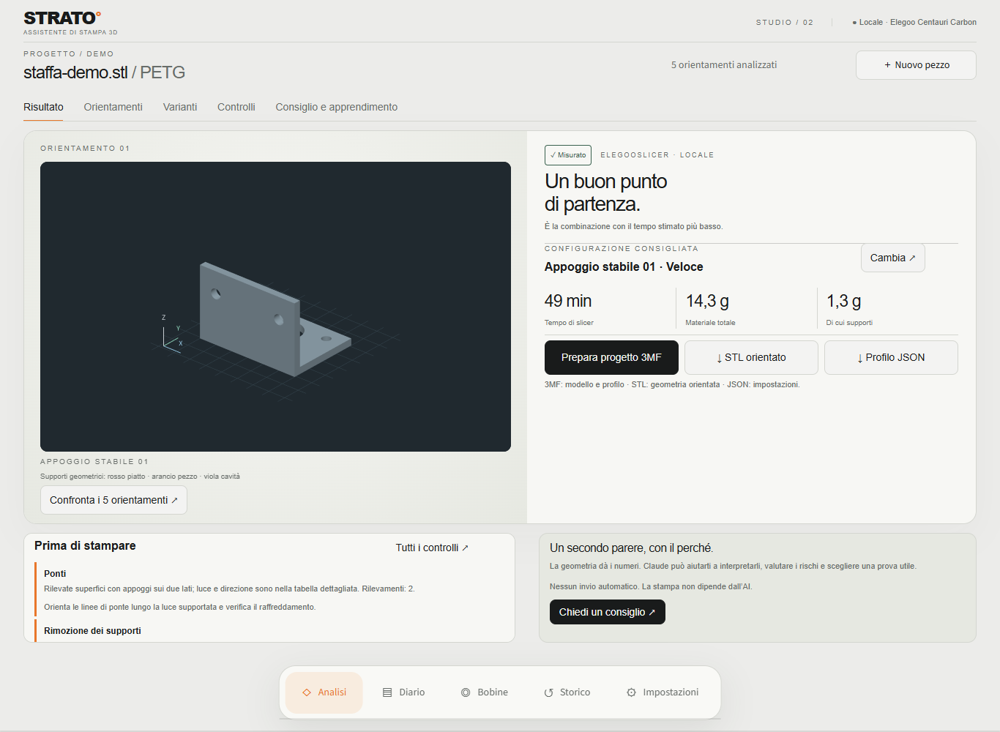
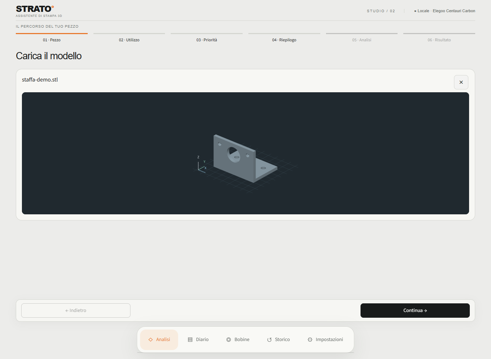
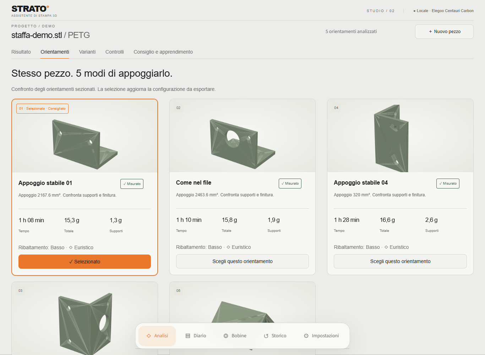
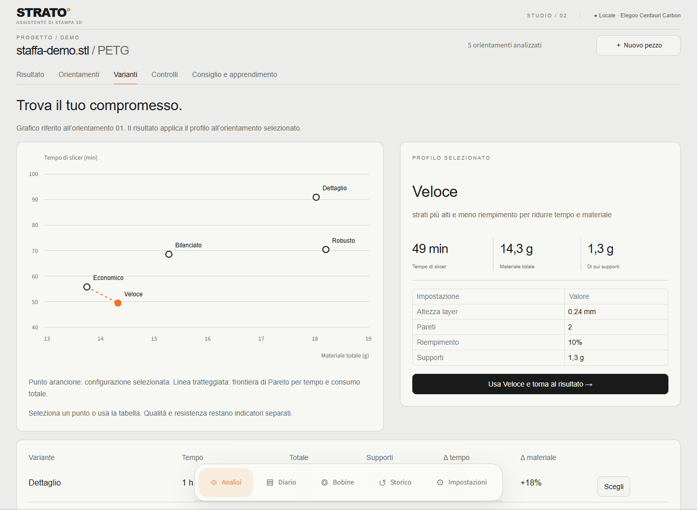

# STRATO · Assistente di stampa 3D

*[Read in English](README.en.md).*

Prepara un modello per la stampa FDM: osserva il pezzo in 3D, confronta orientamenti e profili,
controlla le criticità ed esporta la configurazione scelta. Analisi geometrica, slicing e confronto
funzionano senza AI; Claude aggiunge spiegazioni e diagnosi solo quando lo richiedi.

Questo progetto è stato sviluppato con l'assistenza di agenti di programmazione AI, tra cui
Claude Code e OpenAI Codex, sotto la direzione dell'autore.



## Interfaccia attuale

Il percorso **Pezzo → Utilizzo → Priorità → Riepilogo → Analisi → Risultato** mantiene le scelte
mentre navighi. **Indietro**, **Continua** e, nel riepilogo, **Avvia analisi** restano visibili sopra
la navigazione principale, anche nelle pagine lunghe.

- **Caricamento:** STL, 3MF e OBJ; STEP/STP con l’add-on augura. Un solo box passa dall’upload
  all’anteprima. La **X** rimuove il file e permette un nuovo caricamento.
- **Viewer 3D locale:** rotazione, zoom e spostamento con Plotly, sfondo scuro, griglia del piatto
  e assi XYZ. L’upload mostra il modello neutro; nel risultato le facce possono evidenziare i
  supporti geometrici: rosso dal piatto, arancione sul pezzo, viola in cavità. Questi colori non
  rappresentano il toolpath effettivo: verifica sempre l’anteprima dello slicer.
- **Risultato:** modello orientato, configurazione, tempo e materiale, esportazioni, controlli
  prima della stampa e accesso al consiglio facoltativo di Claude.
- **Orientamenti:** schede con miniature, appoggio, tempi e supporti. La scelta aggiorna la
  configurazione disponibile per l’esportazione.
- **Varianti:** grafico selezionabile tempo/materiale, parametri del profilo e tabella di confronto.
  La linea del grafico è la frontiera di Pareto per tempo e consumo totale; gli indicatori di
  superficie e robustezza restano separati.
- **Controlli** e **Consiglio e apprendimento:** verifiche geometriche, dettagli del toolpath,
  immagini e spiegazioni, senza affollare il riepilogo principale.

La barra inferiore apre **Analisi**, **Diario**, **Bobine**, **Storico** e **Impostazioni**.
Le miniature e le immagini PNG per l’analisi di Claude restano disponibili accanto al viewer.

<details>
<summary>Altre schermate: caricamento, orientamenti e varianti</summary>

### Caricamento e viewer 3D



### Confronto degli orientamenti



### Confronto delle varianti



</details>

Le schermate mostrano l’interfaccia reale in italiano e una staffa generata per la documentazione,
con analisi e slicing locali. Non contengono modelli, diario o inventario personali. Tempi e consumi
sono quelli dell’esempio, non valori applicabili ad altri pezzi.

## Requisiti e avvio

Testato su **Windows con Python 3.12**. Gli script di avvio e i percorsi dello slicer attuali sono
specifici per Windows. Il browser deve supportare WebGL per il viewer interattivo.

- **ElegooSlicer è facoltativo:** serve per tempi/materiali del G-code, confronto dei processi
  ed esportazioni di stampa verificate. La configurazione iniziale è per **Elegoo Centauri Carbon,
  ugello 0,4 mm**, con i profili in `config.py`; i percorsi dell’installazione sono in `slicer_cli.py`.
- **augura è facoltativo:** aggiunge STEP/STP e controlli dedicati, in un ambiente separato.
- **Claude è facoltativo:** le richieste usano il Claude Agent SDK e l’autenticazione disponibile
  nel tuo ambiente Claude Code o `ANTHROPIC_API_KEY`. Per l’analisi locale non serve autenticarsi.

Doppio clic su `avvia.bat`: al primo avvio crea `.venv` e installa `requirements.txt`. Oppure,
dalla cartella del progetto:

```powershell
python -m venv .venv
.venv\Scripts\python.exe -m pip install -r requirements.txt
.venv\Scripts\python.exe -m streamlit run app.py
```

Apri http://localhost:8501. Il server è configurato per essere raggiungibile solo da questo PC.
Dopo un aggiornamento del progetto, reinstalla le dipendenze con
`.venv\Scripts\python.exe -m pip install -r requirements.txt`, anche se `.venv` esiste già.

In **Impostazioni** controlla stampante, disponibilità dello slicer e profilo filamento; da lì puoi
anche gestire augura e scegliere il modello di Claude. Trimesh, Plotly, Matplotlib e l’SDK di Claude
vengono caricati quando servono al modello, al rendering o alla richiesta, non tutti all’avvio.

## Verifiche

Dalla cartella del progetto:

```powershell
.venv\Scripts\python.exe -m unittest discover -s tests -t . -q
```

La suite copre geometria, persistenza, percorso guidato, viewer 3D ed esportazioni.
Un job browser separato verifica upload, navigazione, pulsanti responsive e rendering 3D in Chromium.
Comandi e limiti della suite browser: [CONTRIBUTING.md](CONTRIBUTING.md#browser-tests).
Usa profili sintetici e non richiede ElegooSlicer. I controlli di stampabilità sono
campionati o euristici: non certificano la resistenza del pezzo.

### Percorsi dello slicer e verifica completa

La CI pubblica il report di copertura di righe e rami nel riepilogo di ogni esecuzione,
con i moduli meno coperti. L'artifact `coverage-report` contiene HTML navigabile, JSON e XML
ed è disponibile per 14 giorni. Comandi locali e limiti della misura: [CONTRIBUTING.md](CONTRIBUTING.md#coverage).

I percorsi predefiniti sono definiti in `config.py`. Per cambiarli, impostare prima dell'avvio:

```powershell
$env:STRATO_SLICER_EXE = 'D:\ElegooSlicer\elegoo-slicer.exe'
$env:STRATO_SLICER_PROFILES = 'D:\ElegooSlicer\resources\profiles\Elegoo'
```

Se il percorso dei profili viene omesso, deriva dalla cartella dell'eseguibile.
I percorsi relativi partono dalla cartella del progetto. Impostazioni mostra i percorsi attivi.
La verifica opzionale con lo slicer reale usa dati temporanei:

```powershell
.venv\Scripts\python.exe tests/integrazione_worker.py
```

Senza slicer la verifica dichiara esplicitamente SKIP. Le istruzioni per contribuire sono in
[CONTRIBUTING.md](CONTRIBUTING.md); le segnalazioni riservate seguono [SECURITY.md](SECURITY.md).

## Come funziona

1. **Analisi geometrica** (`analisi.py`, nessuna AI): dimensioni, volume, spessori delle pareti,
   e per ogni orientamento candidato (quello del file più le pose stabili) l'area di appoggio
   e le superfici che chiedono supporti, distinguendo quelli che partono dal piatto da quelli
   che poggerebbero sul pezzo. Tra quelli dal piatto riconosce quelli **dentro una cavità**: a
   qualche quota la colonna di supporto ha il pezzo attorno in tutte le 16 direzioni orizzontali
   (tazza capovolta, scatola aperta sotto). Lo slicer li costruisce, ma dopo la stampa si tolgono
   solo passando dall'apertura sul piatto. Un tunnel aperto ai lati non conta come cavità; una
   fessura laterale più stretta dei raggi può sfuggire.
   Per ogni orientamento controlla anche se il pezzo **si ribalta** (baricentro fuori
   dall'impronta sul piatto) e se serve il **brim**.
   **Punteggio** (più basso = meglio): area dei supporti dal piatto + 3 × quella dei supporti
   sul pezzo + 2 × quella in cavità (che pesa così 3 in tutto) + 0,02 × volume dei supporti + penalità di stabilità. Se il pezzo tocca il piatto
   solo con spigoli (meno di 10 mm²) o si ribalta, ogni problema aggiunge quanto il suo
   **ingombro sul piatto** (minimo 200): un pezzo instabile va sostenuto da brim o supporti per
   tutta la sua ombra. Pesi e soglie sono in cima ad `analisi.py`; la soglia dei supporti è in
   `config.py` (`SOGLIA_SUPPORTI`), la stessa usata dallo slicer nel sezionamento reale.
   Tra i candidati ci sono anche le scelte dell'**orientamento automatico dello slicer**
   (`orienta_slicer.py`): l'algoritmo di OrcaSlicer, da cui deriva ElegooSlicer, tradotto in
   Python, nei due modi in cui lo usa lo slicer (pulsante "Orienta" dell'interfaccia e riga di
   comando). La traduzione è stata verificata contro `elegoo-slicer.exe --orient 1`: stessi
   candidati, costi con scarto mediano 0,1%, stessa scelta. La pagina mostra chi sceglie cosa:
   nostra classifica, slicer e Claude.
2. **Viewer e immagini** (`visualizzatore.py`, `anteprima.py`, `render.py`): anteprima 3D
   interattiva nel caricamento e nel risultato, miniature degli orientamenti e PNG per Claude.
   Le facce colorate distinguono supporti dal piatto, sul pezzo e in cavità: sono indicazioni
   geometriche, non una simulazione del toolpath.
3. **Consiglio** (`consiglio.py`): Claude riceve numeri, immagini, stampante, scopo del pezzo
   e diario, e risponde con orientamento, materiale, impostazioni con il perché, rischi,
   un concetto da imparare e un esperimento.
4. **Diario** (`diario.py`): dopo ogni stampa annoti esito, problemi e foto; Claude può
   fare la diagnosi e le voci entrano nei consigli successivi.

Claude viene usato tramite il **Claude Agent SDK** con le credenziali del tuo ambiente.
Le richieste partono solo quando premi il pulsante di consiglio o diagnosi. Sono consentite
letture di file, non comandi o modifiche; l’ambito effettivo della lettura è descritto in
[Dati inviati a Claude](#dati-inviati-a-claude).

## Sezionamento reale con ElegooSlicer

Se ElegooSlicer è installato, ogni orientamento candidato viene **sezionato davvero** dallo slicer
(`slicer_cli.py`), con i profili di sistema indicati in `config.py` e supporti ad albero solo dal
piatto. Lo slicer non ha un'API: si usa la sua riga di comando (`--slice`, `--load-settings`,
`--load-filaments`) e si leggono i numeri nel G-code:

- **tempo** stimato dallo slicer;
- **grammi di pezzo, supporti e brim**, sommando l'estrusione di ogni tipo (`;TYPE:`) nel G-code.
  Il totale dichiarato dallo slicer è qualche decimo di grammo più alto: conta anche retrazioni e
  spurgo, che non sono materiale depositato.

I profili di sistema ereditano l'uno dall'altro (`inherits`): vengono fusi in profili completi e
lasciati marcati come "system", altrimenti la riga di comando li considera incompatibili (codice −17).
Il profilo filamento si sceglie in **Impostazioni**. Il tempo necessario dipende da geometria, profilo e computer.

Dopo il sezionamento la classifica viene ricalcolata in **grammi equivalenti di supporto**: grammi
reali del G-code, più una stima delle sporgenze che il profilo "solo dal piatto" lascia senza supporto
(peso triplo), il doppio della stima per i supporti in cavità (sono già nei grammi reali: si aggiunge la
difficoltà di toglierli), il 25% del brim e una penalità per gli orientamenti instabili. La conversione usata per
le sole superfici non servite è 5 g ogni 1.000 mm², mediana dei lavori già sezionati. Il punteggio
geometrico resta disponibile e viene usato come fallback se lo slicer manca o fallisce.

Sui primi due orientamenti della classifica reale vengono poi confrontate cinque **varianti di processo**:

- **Dettaglio**: layer 0,12 mm, 3 pareti, riempimento 20%;
- **Bilanciato**: il profilo abituale 0,16 mm, 2 pareti, riempimento 15% (riusa il G-code già prodotto);
- **Veloce**: layer 0,24 mm, 2 pareti, riempimento 10%.
- **Economico**: layer 0,20 mm, 2 pareti, riempimento 8%;
- **Robusto**: layer 0,16 mm, 3 pareti, riempimento 25%.

La dashboard mostra tempo, materiale, supporti e variazioni percentuali rispetto a Bilanciato, quindi
propone una combinazione coerente con la priorità scelta e mostra la frontiera Pareto. Tempo e materiale
sono misurati; superficie e robustezza sono indicatori dichiarati basati su layer, pareti e riempimento.
Le analisi precedenti possono aggiungere Economico e Robusto riusando i sezionamenti già presenti.
La **ricerca progressiva** aggiunge fino a otto prove (quattro per impostazione iniziale), variando un
parametro per volta attorno ai candidati migliori. Layer, pareti e infill restano entro limiti definiti;
le coppie orientamento/impostazioni già provate vengono escluse. I risultati intermedi sono riprendibili.
Il compromesso normalizza tempo, materiale, layer e indicatore di robustezza con pesi del 25% ciascuno.
Si tratta di una ricerca locale: il budget non assicura di aver trovato l'ottimo globale.

Analisi, confronto, immagini e 3MF vengono elaborati da un processo separato: puoi navigare tra le schede.
Una barra si aggiorna ogni due secondi e mostra percentuale, fase, contatore dei passaggi e tempo trascorso.
La percentuale riguarda i passaggi eseguiti, non il tempo residuo; puoi anche premere **Aggiorna avanzamento**.
Se un processo si interrompe, **Riprendi la
lavorazione** recupera i checkpoint; soltanto i sezionamenti non validi vengono eseguiti di nuovo.
Le cache verificano geometria, profili completi, filamento e versione dello slicer. I risultati precedenti
senza queste informazioni richiedono un primo ricalcolo. Il confronto e il 3MF vengono invalidati quando
cambiano i loro input; una configurazione obsoleta non viene offerta come download aggiornato.

Per la combinazione consigliata si possono scaricare un **profilo di processo JSON** importabile in
ElegooSlicer e lo **STL già ruotato e appoggiato sul piatto**. Un terzo pulsante genera con ElegooSlicer
un **progetto 3MF** che contiene modello e configurazioni. Il profilo deriva da quello abituale ed è
esportato completo con le impostazioni della variante e dei supporti usate nel confronto reale.
Orientamento e variante si scelgono dalle schede **Orientamenti** e **Varianti**. Il menu
**Configurazione da esportare**, nella sezione espandibile di **Varianti**, permette di scegliere
qualsiasi combinazione misurata valida,
con quella consigliata inizialmente selezionata. JSON, STL, 3MF e verifica bobina seguono la scelta manuale.
Lo STL contiene soltanto geometria e orientamento: a parità di orientamento non cambia tra varianti.
Per conservare anche layer, pareti, riempimento e filamento usa il progetto 3MF.

Se vengono indicati tipo e direzione del carico, la dashboard confronta anche la componente che agisce
normalmente agli strati nei diversi orientamenti. È un'indicazione relativa sul rischio di delaminazione,
con un primo suggerimento sul numero di pareti; non è una simulazione FEM e non stima il carico di rottura.
Con priorità robustezza viene misurato anche il processo **Meccanico** nell'orientamento indicato,
con il numero di pareti richiesto; i download sono disponibili solo dopo questo confronto. Si possono
indicare fissaggio e applicazione del carico in coordinate del file, vincoli e zona critica. In flessione
l'asse della trave viene dai due punti, distinto dalla forza, ed è riportato il braccio trasversale.
La torsione confronta 32 stati di taglio ideali attorno all'asse, mostrando separatamente apertura e
taglio sul piano layer. Pareti e indice restano euristici: non sono calcolati tensioni assolute, urti o
carichi di rottura, né la distribuzione reale delle tensioni dovuta ai vincoli descritti.

I **controlli avanzati di stampabilità** raccolgono in un'unica tabella problemi della mesh, pareti sotto
due larghezze di linea, ingombro, stabilità, supporti sul pezzo, supporti molto alti e consumo eccessivo di
supporti. I rischi di collisione o supporti intrappolati restano esplicitamente da confermare nell'anteprima.
I **controlli dettagliati** sezionano la mesh per cercare cavità chiuse, accessi insufficienti per un
utensile da 2 mm, piccoli fori/canali, ponti con luce e direzione e isole. Il G-code viene analizzato per
individuare percorsi separati, nuovi inizi senza appoggio e viaggi sotto materiale già depositato;
i campioni di supporto vengono confrontati con le cavità dopo un allineamento stimato. Il rapporto
riporta passo delle sezioni e griglia del percorso, eventuale limite di segmenti o archi non analizzati.
Il controllo campionato può perdere dettagli più piccoli della risoluzione e non simula la testina
completa o le deformazioni della stampa. Le regioni disconnesse possono essere intenzionali.
I solidi sovrapposti nello stesso STL vengono trattati come materiale continuo, come fa lo slicer, e le
loro superfici interne non vengono conteggiate come sporgenze da sostenere.
Prima delle misure viene eseguita un'unione volumetrica con manifold3d: anche volume, superficie e
spessori si riferiscono al materiale risultante. Se i corpi non consentono un'unione affidabile, le
misure quantitative non vengono mostrate come dati validi.

Il diario può registrare anche temperature, velocità, flow, retrazione ed errore dimensionale. Le
**tendenze personali** compaiono solo dopo almeno due osservazioni coerenti per lo stesso materiale:
sono frequenze e mediane leggibili, non un modello che pretende di prevedere difetti con pochi dati.
Le statistiche distinguono profilo e materiale. Le mediane dei parametri usano solo stampe riuscite senza
difetti annotati; le correzioni proposte sono indicazioni predefinite. Nel campo dimensionale vuoto non
c'è una misura, mentre zero indica una misura corretta. Scopo, priorità e carichi sono salvati anche senza Claude.

La scheda **Bobine** conserva materiale, colore, tara, costo e grammi residui. Il residuo si aggiorna
sottraendo una stampa oppure inserendo il peso lordo misurato. Per la configurazione consigliata la
dashboard indica automaticamente se una bobina compatibile basta e stima costo e materiale restante.
La verifica usa il consumo totale dello slicer, avvio incluso, e una riserva del 5%. Sono considerate solo
bobine pronte con materiale riconosciuto; un prezzo non annotato non viene mostrato come costo zero.

## Add-on augura (facoltativo)

[augura](https://github.com/pzfreo/augura) è un secondo analizzatore, basato su build123d e
OpenCASCADE. È disattivato finché non lo si installa: dalla scheda **Impostazioni**
(«Scarica e installa augura») oppure con `addon_augura\installa.bat`. Va in un ambiente a parte,
`.venv-augura` (circa 700 MB); senza, l'assistente funziona come prima. Con l'add-on:

- si possono caricare file **STEP**: vengono convertiti in STL per l'analisi e le immagini;
- sugli STEP augura dà controlli esatti (soffitti e ponti con la loro luce, spessori,
  particolari minimi) e la sua classifica degli orientamenti;
- sugli STL i suoi controlli sarebbero approssimati (sporgenze, ribaltamento, brim) e senza
  ricerca dell'orientamento, cioè doppioni dell'analisi: per questo l'assistente lo usa **solo
  sui file STEP**.

augura non funziona senza build123d (lo importa anche per gli STL), quindi l'add-on non ha una
versione leggera. La versione è bloccata a 0.1.8 perché il progetto è pre-alpha.
Per toglierlo c'è «Rimuovi augura» in **Impostazioni** (oppure si cancella la cartella `.venv-augura`).

## Personalizzare

- `config.py`: stampante, profilo abituale, filamenti, modelli di Claude.
- `consiglio.py`: le istruzioni date a Claude e il formato della risposta.

## Dati

- `lavori/`: una cartella per ogni analisi (file, analisi.json, immagini, sezionamenti, consiglio.md,
  richiesta.json con i campi del modulo, consiglio.json con scelta, modello e costo).
  Ogni analisi si riprende senza ricalcolare niente: dalla scheda **Storico**, ricaricando la
  pagina (il lavoro aperto resta nell'indirizzo, `?lavoro=...`) o caricando di nuovo lo stesso file,
  che viene riconosciuto dall'impronta SHA-256 e propone di riaprire l'analisi salvata.
- `diario.jsonl` e `foto/`: il diario di stampa;
- `bobine.json`: inventario personale delle bobine, escluso da Git.

I database personali (`*.db`, `*.sqlite`, `*.sqlite3`), i relativi file WAL/SHM/journal, i backup nelle
cartelle `backup/` e `backups/`, i log e le credenziali locali sono esclusi da Git. Schema SQL, migrazioni
e generatori di dati sintetici restano versionabili. I file `.env.example`, `.env.sample` e `.env.template`
possono essere condivisi solo con valori dimostrativi. Le regole di esclusione non rimuovono file già
committati né dati presenti nella cronologia Git.

## Dati inviati a Claude

Tutto resta su questo PC finché non chiedi un consiglio o una diagnosi. Solo allora la richiesta va ad
Anthropic tramite il Claude Agent SDK, con il **tuo** login di Claude Code o la tua `ANTHROPIC_API_KEY`:
il progetto non contiene e non salva credenziali.

- **Consiglio**: stampante (`config.py`), campi del modulo (scopo, priorità, carichi), l'analisi in JSON
  (misure, orientamenti, risultati dello slicer) e le ultime 15 voci del diario; Claude apre con lo
  strumento di lettura le immagini degli orientamenti nella cartella del lavoro.
- **Diagnosi**: stampante (`config.py`), la voce del diario, le sue foto e le altre voci recenti.

Claude ha solo lo strumento di lettura: niente comandi né modifiche. Per il consiglio parte dalla cartella del
lavoro, dove c'è anche il file del modello; per la diagnosi dalla cartella del progetto, che contiene anche
`lavori/`, `foto/` e il diario. La cartella di partenza **non è un limite**: lo strumento di lettura può aprire
qualsiasi file leggibile del PC, anche se le istruzioni gli indicano solo i dati e le immagini della richiesta.
Le impostazioni e la memoria personali di Claude Code non vengono caricate.

## Licenza

Copyright (C) 2026 Andrea Cirrincione.

Questo programma è software libero: puoi ridistribuirlo e/o modificarlo secondo i termini della
**GNU Affero General Public License versione 3** (AGPL-3.0), pubblicata dalla Free Software Foundation.
È distribuito nella speranza che sia utile, ma **senza alcuna garanzia**. Il testo completo è nel file
[`LICENSE`](LICENSE).

In breve: chiunque può usare, studiare, modificare e ridistribuire il programma, anche a pagamento, ma
le versioni modificate, anche quelle offerte solo come servizio web, devono restare AGPL-3.0 con il
codice sorgente disponibile per chi le usa.

`orienta_slicer.py` è una traduzione in Python di codice di [OrcaSlicer](https://github.com/SoftFever/OrcaSlicer),
anch'esso rilasciato sotto AGPL-3.0; i file originali sono indicati nell'intestazione del modulo.
